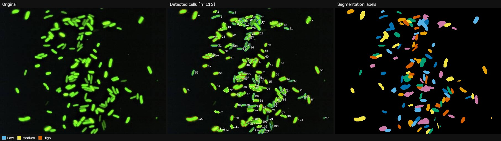

# Cell Identifier

**Reproducible detection, segmentation and measurement of cells in fluorescence microscopy images, by iGEM Team DelNorte-SD.**

[](https://github.com/delnorte-sd/Cell-Identifier/actions/workflows/ci.yml)

[](http://creativecommons.org/licenses/by-nc-sa/4.0/)

Cell Identifier turns a fluorescence micrograph into a table of cells: where each one is, how big, what shape and how bright. It runs as a Python library, a command-line tool for batch work, or a web app. A built-in synthetic image generator with exact ground truth lets you **measure** how accurate the pipeline is instead of guessing.



*The bundled E. coli GFP sample: 116 cells found with default settings. Outlines are coloured by brightness class (Okabe–Ito colour-blind-safe palette).*

---

## Highlights

| | |
|---|---|
| **Scientifically grounded** | Classical, inspectable image analysis: robust noise-floor thresholding, h-maxima marker watershed, moment-based shape metrics. No black-box model, no GPU. |
| **Validated** | Scored against exact ground truth. Separated cells: F1 = 1.000. Overlapping rods and ellipses: mean F1 = 0.976 and 0.965 (5 seeds each, IoU > 0.5). |
| **Reproducible** | Deterministic pipeline. Every report records the software version, the input file's SHA-256, the full configuration and a timestamp. |
| **Bit-depth aware** | 8-bit and 16-bit images give identical segmentations; intensities are reported in the native units of the image. |
| **Three interfaces** | `analyze()` in Python, `cell-identifier` on the command line, and a Flask web UI. |
| **Tested** | 161 tests, 97 % branch coverage, CI on Linux, Windows and macOS. |

## Quickstart

```bash
git clone https://github.com/delnorte-sd/Cell-Identifier.git
cd Cell-Identifier
python -m venv .venv && source .venv/bin/activate   # Windows: .venv\Scripts\activate
pip install -e ".[web,plot,dev]"
```

### Command line

```bash
# Analyse one image, several images, or whole folders (add -r to recurse)
cell-identifier analyze my_images/ -o results/

# Override any setting inline, or load a TOML/JSON config file
cell-identifier analyze cells.tif -o results/ \
    --set segmentation.threshold_method=triangle --set filter.exclude_border=true
cell-identifier analyze cells.tif -c examples/analysis.toml --figure

# Generate synthetic images with ground truth, and score the pipeline on them
cell-identifier generate -n 80 --seed 1 --count 5 -o synthetic/
cell-identifier benchmark --count 10 --overlap

# Show the effective configuration, or start the web app
cell-identifier config
cell-identifier serve            # http://127.0.0.1:5000
```

Each analysed image gets its own folder:

| File | Contents |
|---|---|
| `results.json` | Provenance (software version, input SHA-256, configuration), summary statistics, every cell |
| `cells.csv` | One row per cell (columns listed [below](#measurements)) |
| `overlay.png` | The original image with cell outlines and IDs |
| `labels.png` / `labels_16bit.png` | Colour label map / raw 16-bit label IDs for downstream tools |
| `figure.png` | Side-by-side original, overlay and label map |
| `distributions.png` | Area and intensity histograms (with `--figure`; needs the `plot` extra) |

A batch also writes `summary.csv` with one row per image, including any failures. The exit code is non-zero if any image failed.

### Python

```python
from cell_identifier import AnalysisConfig, analyze, generate, match_labels
from cell_identifier.config import apply_overrides
from cell_identifier.reporting import write_outputs

result = analyze("cells.png")                       # path, bytes or numpy array
print(result.cell_count, result.summary()["area_px"])
for cell in result.cells[:3]:
    print(cell.cell_id, cell.centroid_x, cell.centroid_y, cell.area_px, cell.brightness)
write_outputs(result, "results/cells")

# Custom settings, e.g. 0.065 µm pixels, triangle threshold, drop edge cells
config = apply_overrides(
    AnalysisConfig(pixel_size_um=0.065),
    ["segmentation.threshold_method=triangle", "filter.exclude_border=true"],
)
result = analyze("cells.tif", config)

# Validate against ground truth
synthetic = generate(seed=0, num_cells=60, shape="ellipse", allow_overlap=True)
scores = match_labels(analyze(synthetic.image).labels, synthetic.labels)
print(scores.precision, scores.recall, scores.f1)
```

### Web app

```bash
cell-identifier serve                 # local development
gunicorn app:app                      # production (this is what Render runs)
```

The web app has two tabs. **Analyze Real Images** takes an upload (or the bundled sample) and lets you adjust the calibration, then shows the figure and statistics and offers CSV, JSON and overlay downloads. **Generate Synthetic Cells** creates seeded images and can score detection against the ground truth on the spot. Uploads are processed in memory and never written to disk.

## How it works

```
image ─► image_io ─► preprocessing ─► segmentation ─► measurement ─► classification ─► reporting
         validate     channel          threshold +       shape &        brightness        JSON / CSV
         decode       denoise          noise floor       intensity      classes           figures
         hash         background       morphology        filters,                         overlays
                                       watershed         stable IDs
```

| Module | Responsibility |
|---|---|
| `config` | Frozen, validated dataclasses holding every parameter, with units and meaning documented. TOML/JSON loading and `key=value` overrides. |
| `image_io` | Decodes PNG/JPEG/TIFF/BMP in memory, preserves 16-bit data, validates shape, dtype and size, computes the SHA-256. |
| `preprocessing` | Extracts the signal channel, denoises (Gaussian/median), corrects background (top-hat or Gaussian), optionally normalises. |
| `segmentation` | Otsu, triangle, fixed or adaptive threshold, held above a robust noise floor; morphology; marker watershed split. |
| `measurement` | Per-cell shape and intensity metrics, area and border filters, raster-order stable IDs. |
| `classification` | Low / Medium / High brightness, by absolute cut-offs or per-image tertiles. |
| `pipeline` | `analyze()`, a pure function of (image, config) that returns an `AnalysisResult`. |
| `visualization` / `figures` | Non-destructive overlays, label maps, comparison panels, optional matplotlib plots. |
| `reporting` | Self-describing JSON, per-cell and batch CSV, output bundles. |
| `synthetic` / `evaluation` | Ground-truth generator (isolated from the analysis code) and IoU-based precision/recall/F1. |
| `cli` / `web` | Thin user interfaces over the library. |

### Scientific background

1. **Two intensity images.** The pipeline *finds* cells on a denoised, optionally background-corrected copy, but *measures* intensity on the raw signal. Filtering would otherwise bias the numbers.
2. **Thresholding with a noise floor.** Otsu's method (the default) always splits the histogram in two, even when the image is pure noise. The threshold is therefore never allowed below `median + k·σ` (default `k = 3`). Here σ is 1.4826 × the median absolute deviation of the image after removing its local mean, which makes it robust to cells and to illumination gradients. As a result, an empty field correctly yields zero cells.
3. **Separating touching cells.** A marker-controlled watershed assigns each foreground pixel to one seed. Seeds are *h-maxima*: local maxima that rise at least `h` above their surroundings, which stops pixel noise from fragmenting cells.
   - `split_method = "intensity"` (default) floods the smoothed signal. It cuts along dark valleys, which is the only cue available for rods lying side by side.
   - `split_method = "distance"` floods the distance transform of the mask. It cuts at geometric necks and suits round cells of uniform brightness, which have no intensity valley between them.
4. **Measurements.** Area is an exact pixel count; perimeter uses scikit-image's corner-weighted estimator. Axes, eccentricity and orientation come from the ellipse with the same second moments. Circularity = 4π·area/perimeter², and solidity = area/convex-hull area. Intensity is reported as mean, max, integrated (sum) and background-corrected mean (mean minus the median of all background pixels). When `pixel_size_um` is set, sizes are also given in µm and µm², and density per mm².
5. **Stable IDs.** Cells are numbered in raster order of their centroids, so the same input and configuration always produce the same IDs. IDs in the CSV match those drawn on the overlay and stored in `labels_16bit.png`.

The full method notes, assumptions and limitations are in [docs/METHODS.md](docs/METHODS.md).

### Measurements

`cells.csv` columns: `cell_id`, `centroid_x`, `centroid_y`, `bbox_x`, `bbox_y`, `bbox_width`, `bbox_height`, `area_px`, `perimeter_px`, `equivalent_diameter_px`, `major_axis_px`, `minor_axis_px`, `orientation_deg`, `eccentricity`, `aspect_ratio`, `circularity`, `solidity`, `mean_intensity`, `max_intensity`, `integrated_intensity`, `mean_intensity_corrected`, `touches_border`, `brightness`, `area_um2`, `equivalent_diameter_um`, `major_axis_um`, `minor_axis_um`.

## Configuration guide

All settings live in [`src/cell_identifier/config.py`](src/cell_identifier/config.py), where each parameter's docstring gives its unit and meaning. Intensity thresholds are **fractions of full scale** (0–1), so a single configuration works for 8-bit and 16-bit images alike. Run `cell-identifier config` to print every default; [`examples/analysis.toml`](examples/analysis.toml) is a commented template.

| Setting | Default | When to change it |
|---|---|---|
| `preprocess.channel` | `gray` | Use `green` for GFP in RGB images, or the channel that carries your signal. |
| `preprocess.background` | `none` | Use `tophat` with `background_radius` larger than a cell radius for vignetting or haze. |
| `segmentation.threshold_method` | `otsu` | `triangle` for sparse, dim cells; `adaptive` for strongly uneven illumination; `fixed` for strict cross-image comparability. |
| `segmentation.min_snr` | `3.0` | Lower it to detect fainter cells (with more risk of noise); set `0` to disable the floor. |
| `segmentation.split_method` | `intensity` | `distance` for round, evenly bright cells; `none` to keep clumps whole. |
| `segmentation.intensity_h` / `watershed_h` | `0.05` / `1.0` | Raise to merge more (cells cut in pieces); lower to split more (clumps not separated). |
| `filter.min_area` / `max_area` | `15` / `5000` px | Set from your cell size; reject debris and clumps. |
| `filter.exclude_border` | `false` | Use `true` for size and shape statistics (cut-off cells bias them low). |
| `classification.method` | `absolute` | `quantile` for within-image tertiles; `none` to skip. |
| `classification.low_cutoff` / `high_cutoff` | 142/255, 156/255 | **Re-calibrate for your microscope and exposure.** The defaults are the tertiles of the bundled sample. |
| `pixel_size_um` | unset | Set it to get µm / µm² outputs and densities per mm². |

> **Calibration advice.** Before a study, run `cell-identifier benchmark` with synthetic settings that resemble your images, and inspect `figure.png` for a few real images. Fix one configuration file for the whole experiment and keep it with the data. The JSON reports record it automatically.

## Development

```bash
pip install -e ".[dev,web,plot]"
pytest                               # 161 tests
pytest --cov                         # with coverage
ruff check src tests app.py          # lint
ruff format src tests app.py         # format
mypy                                 # type-check
```

CI (`.github/workflows/ci.yml`) runs lint, type checks, the test suite on Python 3.11–3.13 (plus Windows and macOS), a synthetic benchmark, and a wheel build that is smoke-tested in a clean environment.

**Project layout**

```
src/cell_identifier/     library (config, image_io, preprocessing, segmentation, measurement,
                         classification, pipeline, visualization, figures, reporting,
                         synthetic, evaluation, cli)
src/cell_identifier/web/ Flask app, template, static assets and the bundled sample image
tests/                   pytest suite (deterministic, seeded fixtures)
docs/                    method notes and images
examples/                example configuration
app.py                   WSGI entry point for `gunicorn app:app`
```

**Extending.** New stages plug in as pure functions over numpy arrays with a matching config dataclass, for example a new threshold method in `segmentation.compute_threshold` or a new descriptor in `measurement.measure_cells`. Add a ground-truth benchmark test for any change that affects detection.

## Deployment

`render.yaml` deploys the web app on [Render](https://render.com): `pip install -r requirements.txt` installs this package with its `web` extra, and `gunicorn app:app` serves it. Uploads are limited to 16 MB, and `GET /healthz` reports status and version.

## License

This work is licensed under a [Creative Commons Attribution-NonCommercial-ShareAlike 4.0 International License](http://creativecommons.org/licenses/by-nc-sa/4.0/).

You are free to **share** (copy and redistribute the material in any medium or format) and **adapt** (remix, transform and build upon the material) under these terms:

- **Attribution:** give appropriate credit, provide a link to the license, and indicate if changes were made.
- **NonCommercial:** you may not use the material for commercial purposes.
- **ShareAlike:** if you remix, transform or build upon the material, you must distribute your contributions under the same license.

[](http://creativecommons.org/licenses/by-nc-sa/4.0/)
