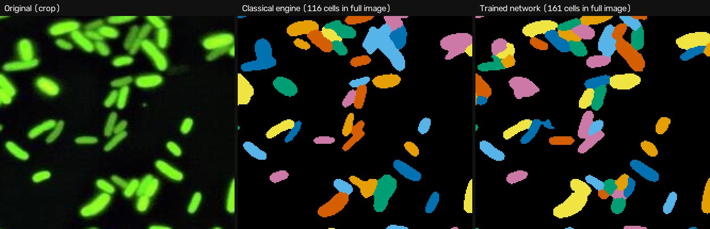

# Software

Cell-Identifier is a web tool that finds, outlines and measures every bacterial cell in a fluorescence micrograph. Its neural network was trained on expert-annotated images and scored on images it never saw during training.

## Why We Developed the Software

Most of our constructs report through fluorescence: a cell expressing GFP glows, and the number of glowing cells and how brightly each one glows tell us whether a genetic circuit works. Turning a micrograph into those numbers means finding every cell, separating cells that touch, and measuring each one. Done by hand, this is slow and subjective. Two people counting the same image rarely agree, and nobody can outline 150 touching rods the same way twice.

We needed a tool that does this automatically and reproducibly, and that we could trust. Trust here means the tool's accuracy has been measured against real, expert-annotated images, not just checked by eye.

We also had a practical constraint: the tool had to run on a website, on free cloud hosting, so any team member can use it from a browser without installing anything. That ruled out large models that need a GPU.

This page describes how the software is built, how it evolved through four design iterations, the model we trained, how we validated it, and what it can and cannot do.

## System Architecture

The software has three layers:

**Analysis engine (Python package).** This layer turns an image into a table of cells. It is a chain of independent stages:
- loading and validating the image
- normalising it
- segmentation (finding cells and separating touching ones)
- measurement
- brightness classification
- reporting

Every setting lives in one validated configuration, and every result records that configuration, the software version and a SHA-256 fingerprint of the input file. So any number can be traced back to exactly how it was produced.

**Segmentation engines.** Two engines are interchangeable:
- **Trained network (default).** A compact U-Net that predicts, for every pixel, whether it belongs to a cell, whether it lies on a cell boundary, and how far it is from the cell's edge. A watershed step then turns these maps into individual cells.
- **Classical (fallback).** Thresholding above a noise floor, followed by a watershed. It is fast and fully transparent, and is useful for round cells, which the network was not trained on.

**Interfaces.**
- a **web app** with an image viewer, toggleable layers, a side-by-side comparison and exports
- a **command-line tool** for batch analysis and for scoring against your own annotations
- a **Python API**

**Design constraint.** The network has to be accurate on real micrographs *and* light enough to run on a server with 512 MB of memory and about a tenth of a CPU core.

## Design Iterations

The software went through four design passes. Each one was measured, and each measurement exposed the weakness the next iteration fixed.

### Iteration 1 of 4: the original app

The first version was a single 490-line script. It set a fixed brightness threshold (50 of 255), cleaned up the mask with a 5 × 5 pixel filter, and counted the remaining blobs.
- On synthetic images with a known number of cells (60 per image), it found **55–57 of 60** rod-shaped cells but only **4–17 of 60** elliptical cells. The fixed threshold missed dim cells, and the clean-up filter erased thin ones.
- Its built-in demo crashed on colour images.
- An uploaded file's name went straight into the save path, which would let a crafted filename write files outside the upload folder.

### Iteration 2 of 4: classical engine, rebuilt

We rebuilt the engine as a modular, tested package:
- an automatic (Otsu) threshold, held above a robust noise floor
- a watershed that separates touching cells along dark gaps between them
- shape and intensity measurements
- a synthetic image generator with exact ground truth

On synthetic images it became essentially perfect (F1 = 1.000 for separated cells, 0.965–0.976 with overlap).

We then scored it on **real micrographs annotated by experts**. It reached only **AP @ 0.5 = 0.350** (F1 = 0.503). Synthetic success did not carry over to real cells: real bacteria touch along their whole length, vary in brightness and sit on hazy backgrounds. An alternative variant that splits cells by shape alone scored even worse (AP @ 0.5 = 0.036).

### Iteration 3 of 4: trained network

We trained a U-Net on real annotated images (see *Dataset Selection*). After just 200 training steps, about one minute on a laptop GPU, the network reached AP @ 0.5 = 0.77 on the test images **when told the true cell size**. With a simple size estimate it fell to 0.20.

That pinpointed the real bottleneck: **estimating cell size**, which decides how much the image is rescaled before the network sees it. We replaced the estimate with one that uses the network itself (see *Computational Pipeline*). After full training (12,000 steps, 23 minutes), the network scored **AP @ 0.5 = 0.876**.

### Iteration 4 of 4: hardening for real use and for the website

Testing on edge cases revealed two failures:
1. **A pure-noise image produced 327 "cells".** The network stretches contrast before analysing an image, so it can hallucinate structure in noise.
2. **The bundled sample produced a ragged false "cell"** in a patch of out-of-focus haze.

We added two quality gates: a confidence threshold, and a physical brightness test (a cell must be at least 3 noise standard deviations brighter than the background). Noise images now give **0 cells**, the haze artefact is gone, and test accuracy barely changed (AP @ 0.5 0.876 → 0.871).

We also trained a lighter model (1.1 M parameters, working at a smaller scale) for speed. It reached a validation score of only 0.404 at the point where the chosen model had 0.52, so it was rejected. Instead we cut memory use by processing large images in tiles and separating each cell clump on its own.



*The same crop of our E. coli GFP sample. The classical engine merges packed rods into irregular blobs; the trained network separates them. Full-image counts: 116 vs 161 cells.*

## Dataset Selection: Omnipose *bact_fluor*

Many cell-segmentation datasets exist, but few contain **fluorescent bacteria** with **instance masks**, where every individual cell is outlined, which is what our use case needs. We searched Kaggle and the scientific repositories (Zenodo, OSF). The best match was the *bact_fluor* set published with Omnipose (Cutler et al., 2022).

| Parameter | Value |
|---|---|
| Dataset | Omnipose *bact_fluor* (osf.io/xmury) |
| License | CC BY-NC 3.0 (compatible with our non-commercial project) |
| Images | 218 (143 training + 75 test), 16-bit greyscale |
| Annotated cells | 35,403 |
| Organisms | *E. coli*, *E. coli* + A22, *E. coli* + cephalexin, *B. thailandensis*, *Vibrio* |
| Download used | 241 MB (images and masks only) |

**Fit to our images.** We compared typical cell sizes, measured from the expert masks, with our own sample:

| Group | Cell width (px) | Cell length (px) |
|---|---|---|
| *E. coli* ("wiggins", 117 images) | 8.8 | 25.0 |
| *E. coli* + A22 (rounded) | 21.7 | 37.5 |
| *B. thailandensis* | 14.1 | 32.7 |
| *Vibrio* | 13.0 | 32.6 |
| *E. coli* + cephalexin (filaments) | 26.6 | 133.8 |
| **Our sample (*E. coli* GFP)** | **9.8** | **24.9** |

The largest group, ordinary *E. coli*, matches our sample almost exactly.

**Data split.** We used the dataset's own test split (75 images) **only for the final evaluation**. From the training images we held out 15 % per group (21 images) for validation, which was used to choose checkpoints and tune thresholds. The remaining 122 images were used for training.

## Modeling Approach

We use a **U-Net**, a convolutional network that compresses the image to capture context, then expands it back to full resolution to label every pixel. We chose it over larger models because it is accurate on microscopy and small enough for a free web server.

For each pixel the network predicts three maps:

- **Foreground probability.** Is this pixel part of a cell?
- **Boundary probability.** Is it on a cell's edge, including the seam where two cells touch?
- **Normalised distance.** How deep inside its cell is it? This is 1 on the cell's midline and 0 at its edge.

The distance map is what lets us separate rods that touch along their entire length. Their midlines stay apart even when their edges merge, so each midline becomes a seed for one cell.

**Scale.** The network works at one fixed scale. Every image is resized so that cells are about 10 px wide, and the results are resized back.

**Augmentation.** To make a model trained on 16-bit laboratory images work on 8-bit colour photos, training images were randomly:
- rescaled (0.7–1.45×), rotated and flipped
- shifted in brightness, contrast and gamma
- blurred and given Gaussian and photon (Poisson) noise
- converted to 8 bits and JPEG-compressed

**Training.**

| Setting | Value |
|---|---|
| Patch size / batch | 256 × 256 px / 16 |
| Iterations | 12,000 |
| Optimiser | AdamW with one-cycle learning rate (peak 2 × 10⁻³) |
| Loss | foreground: cross-entropy + Dice; boundary: weighted cross-entropy + Dice; distance: mean squared error |
| Hardware / time | NVIDIA RTX 4060 laptop GPU, 23 minutes |
| Checkpoint selection | best mean of AP @ 0.5 and AP @ 0.75 on the validation images |

**Scoring.** We use the standard instance-segmentation metric, **average precision (AP)**:

AP = matched cells ÷ (matched + missed + spurious cells)

A predicted cell counts as matched when it overlaps a true cell by more than a given **IoU** (intersection over union). We report AP at IoU 0.5, 0.75 and 0.9 (increasingly strict), plus **F1** at IoU 0.5.

## Computational Pipeline

The script below is the core of how an image becomes a list of cells. It is a condensed but faithful version of the software's `learned.py` (some steps are noted as comments).

```python
import cv2
import numpy as np
from scipy import ndimage
from skimage.measure import regionprops
from skimage.segmentation import watershed

net = cv2.dnn.readNetFromONNX("cell_unet.onnx")    # 7.9 MB, runs on CPU, no PyTorch
TARGET_WIDTH = 10.0                                # cell width the network was trained at

def normalise(img):
    lo, hi = np.percentile(img, [1, 99.8])         # robust to bit depth and exposure
    return np.clip((img - lo) / (hi - lo), 0, 1).astype(np.float32)

def predict(img):
    h, w = img.shape
    padded = np.pad(img, ((0, -h % 16), (0, -w % 16)), mode="reflect")
    net.setInput(padded[None, None])
    return net.forward()[0, :, :h, :w]             # foreground, boundary, distance

def estimate_cell_width(img, passes=4):
    """Let the network measure the cells, then rescale until they are ~10 px wide."""
    width = TARGET_WIDTH
    for _ in range(passes):
        factor = TARGET_WIDTH / width
        crop = cv2.resize(img[:256, :256], None, fx=factor, fy=factor)   # (real code picks the brightest crop)
        cells = segment(predict(crop))
        measured = np.median([r.axis_minor_length for r in regionprops(cells)])
        width *= measured / TARGET_WIDTH
        if abs(np.log(measured / TARGET_WIDTH)) < 0.15:                 # converged
            break
    return width

def segment(maps, prob=0.35, seed=0.5):
    fg, boundary, dist = maps
    mask = fg > prob
    seeds, _ = ndimage.label((dist > seed) & mask & (boundary < 0.5))   # cell midlines
    return watershed(-dist, seeds, mask=mask)                            # grow seeds to edges

def analyse(raw):
    img = normalise(raw)
    factor = TARGET_WIDTH / estimate_cell_width(img)
    maps = predict(cv2.resize(img, None, fx=factor, fy=factor))          # (real code tiles big images)
    maps = np.stack([cv2.resize(m, raw.shape[::-1]) for m in maps])      # back to original pixels
    cells = segment(maps)
    # Quality gates: drop objects with mean foreground probability < 0.7, and
    # objects whose raw brightness is < background + 3 robust noise SDs.
    return cells
```

The full software adds the following on top of this core:
- tiling, so large images stay within memory
- per-clump watershed
- the two quality gates
- measurement of 27 properties per cell (from the raw intensities, never the processed image)
- brightness classes, reports and the web viewer

Training uses the same `normalise` function and target definitions, so training and inference cannot drift apart.

## Results

All results are on the **75 held-out test images (15,596 expert-annotated cells)**. None of them was used for training, checkpoint selection or tuning.

### 1. Threshold tuning on validation data

Three post-processing settings were grid-searched on the validation images only. The best five combinations:

| Foreground threshold | Seed threshold | Min. confidence | Val. AP @ 0.5 | Val. AP @ 0.75 |
|---|---|---|---|---|
| **0.35** | **0.50** | **0.70** | **0.731** | **0.566** |
| 0.35 | 0.50 | 0.60 | 0.730 | 0.565 |
| 0.35 | 0.40 | 0.70 | 0.723 | 0.571 |
| 0.45 | 0.50 | 0.70 | 0.728 | 0.565 |
| 0.45 | 0.50 | 0.60 | 0.727 | 0.565 |

The top settings lie within 0.01 of each other, so performance does not hinge on a fragile choice of thresholds.

### 2. Accuracy on held-out test images

| Engine | AP @ 0.5 | AP @ 0.75 | AP @ 0.9 | F1 @ 0.5 |
|---|---|---|---|---|
| Classical engine (iteration 2) | 0.350 | 0.177 | 0.007 | 0.503 |
| **Trained network, automatic cell size (default)** | **0.871** | **0.730** | **0.077** | **0.927** |
| Trained network, given the true cell size | 0.859 | 0.721 | 0.075 | 0.916 |

By organism:

| Group | Images | Classical AP @ 0.5 | Network AP @ 0.5 | Network AP @ 0.75 | Network F1 |
|---|---|---|---|---|---|
| *E. coli* | 58 | 0.340 | **0.893** | 0.743 | 0.942 |
| *Vibrio* | 7 | 0.554 | **0.905** | 0.780 | 0.949 |
| *E. coli* + A22 | 2 | 0.553 | **0.896** | 0.836 | 0.942 |
| *B. thailandensis* | 6 | 0.221 | **0.729** | 0.609 | 0.840 |
| *E. coli* + cephalexin | 2 | 0.114 | **0.536** | 0.430 | 0.648 |

### 3. Cell-size estimation

Getting the scale right turned out to matter more than anything else (see Iteration 3). We compared three ways of estimating cell width on the 75 test images. Error is relative to the expert-measured median width. Times are on a single CPU thread.

| Method | Median error | Within 25 % | Time per image |
|---|---|---|---|
| Quick threshold-based estimate | n/a (led to AP @ 0.5 = 0.20) | n/a | < 0.1 s |
| Try 8 fixed sizes, keep the most consistent | 206 % | 44 % | 1.11 s |
| **Iterative: let the network measure, then rescale (used)** | **2.6 %** | **99 %** | **0.31 s** |

### 4. Edge cases and quality gates

| Input | Before gates | After gates |
|---|---|---|
| Pure noise, 256 × 256 px (3 random images) | 327 cells | **0 cells** |
| Blank image | 0 cells | 0 cells |
| Out-of-focus haze in our sample | 1 ragged false cell | removed |
| Test-set AP @ 0.5 | 0.876 | 0.871 |

### 5. Training progress (validation set)

| Training step | Val. AP @ 0.5 | Val. AP @ 0.75 | Time |
|---|---|---|---|
| 500 | 0.556 | 0.274 | 1.5 min |
| 3,000 | 0.690 | 0.422 | 8.5 min |
| 7,500 | 0.700 | 0.534 | 16.0 min |
| 12,000 (final) | 0.724 | 0.562 | 23.2 min |

### 6. Resource use on a web server

Measured with a single CPU thread, to approximate the free hosting tier:

| Measurement | Value |
|---|---|
| Model file | 7.9 MB (1.96 M parameters) |
| Server memory, idle with model loaded | ~110 MB |
| Analysing the sample (600 × 456 px): CPU time / peak memory | 1.9 s / ~275 MB |
| Analysing a 2048 × 2048 px image: CPU time / peak memory | 27 s / ~480 MB |
| A 6 MP image before memory optimisation | 663 MB peak (over the 512 MB limit) |
| Alternative runtime (ONNX Runtime) instead of OpenCV | only 1.1× faster, so not adopted |

### Main findings

- **Accuracy.** Training on real annotated cells raised AP @ 0.5 from 0.350 to **0.871** and F1 from 0.503 to **0.927**, a 2.5-fold improvement. On ordinary *E. coli*, the cells most like ours, F1 is **0.942**.
- **Scale is the key variable.** The same network scored 0.20 or 0.87 depending only on how the image was rescaled. Our self-measuring size estimate even beat giving the network the true size (0.871 vs 0.859): for elongated filaments, the median width is not the ideal working scale.
- **Specificity.** The quality gates turned 327 false detections in pure noise into 0, at a cost of 0.005 AP on real data.
- **Portability.** The 7.9 MB model runs inside OpenCV with no extra dependencies and fits a 512 MB server.

## Protocol for Use

How to get reliable numbers from your own images:

1. **Image acquisition.** Image cells in a single focal plane, at the same exposure and gain for every sample you intend to compare. Avoid saturating pixels; brightness measurements are meaningless at saturation. TIFF (8- or 16-bit) is best; PNG and JPEG work.
2. **Analysis.** Open the image in the web app, or run `cell-identifier analyze images/ -o results/` for a whole folder. The default settings were tuned on held-out data and need no adjustment for typical rod-shaped bacteria. If cells are unusually small or large, enter their approximate width in pixels under *Detection & segmentation*.
3. **Check.** Toggle the outline layer, and use *Compare* to view original and annotated side by side. In *Validate* mode the tool scores itself against images with known answers.
4. **Calibrate brightness classes.** The Low / Medium / High cut-offs (126 and 147 of 255) were set on our sample. For your own experiment, image a negative and a positive control under identical settings and set the cut-offs from them in a configuration file.
5. **Validate on your own data (recommended).** Hand-annotate two or three of your images (for example in Fiji), then run `cell-identifier evaluate my_images/ --masks my_masks/` to measure accuracy on your own microscope.
6. **Report.** Export the cell table (CSV) and the full report (JSON). The report records the software version, the input file's fingerprint and every setting used, so the analysis can be reproduced exactly.

## Predictions and Design Implications

- **Expected accuracy on our images.** Our sample closely matches the *E. coli* test group (width 9.8 vs 8.8 px, length 24.9 vs 25.0 px). We therefore expect roughly F1 ≈ 0.94 on our own GFP *E. coli* images. This is a prediction, best confirmed with step 5 of the protocol.
- **Where to be careful.** Filamentous cells (F1 0.65) and densely packed *B. thailandensis* (0.84) are measurably harder. Round cells (cocci, yeast) are outside the training data and can be split in two. Use the classical engine, or set the cell width manually, for those.
- **Pixel-perfect outlines.** AP @ 0.9 remains low (0.077). On cells only ~9 px wide, outlines must agree with the annotator to within about one pixel, roughly the annotators' own uncertainty. Counts and positions are reliable; area values carry about ±1 px of boundary uncertainty.
- **Free hosting is slow, not broken.** With about 0.1 CPU core, the sample takes roughly 20 s, and uploads are capped at 2 MP. A server with 0.5 CPU or more brings that down to a few seconds and allows 4 MP images.

## Conclusion

This page describes the design, training and validation of Cell-Identifier's cell-segmentation engine. We showed that:

- Rules tuned on synthetic images fail on real micrographs: AP @ 0.5 = 0.350 against expert annotations.
- A compact U-Net trained on 122 expert-annotated fluorescence images reaches **AP @ 0.5 = 0.871 and F1 = 0.927** on 75 unseen test images, and **F1 = 0.942** on *E. coli*.
- Estimating cell size with the network itself is essential: it lands within 25 % of the true size on 99 % of test images.
- Physical quality gates eliminate false detections in noise without hurting accuracy.
- The whole system fits a 7.9 MB model and a 512 MB web server, so anyone can use it from a browser.

Every number on this page was measured on held-out data. The website includes a validation mode and an evaluation command, so users can check the tool on their own images rather than take it on trust.

## References

Cutler, K.J., Stringer, C., Lo, T.W., et al. "Omnipose: a high-precision morphology-independent solution for bacterial cell segmentation." *Nature Methods*, vol. 19, pp. 1438–1448, 2022. (Training data: *bact_fluor*, osf.io/xmury, CC BY-NC 3.0.)

Ronneberger, O., Fischer, P., Brox, T. "U-Net: Convolutional Networks for Biomedical Image Segmentation." *MICCAI*, LNCS 9351, pp. 234–241, 2015.

Stringer, C., Wang, T., Michaelos, M., Pachitariu, M. "Cellpose: a generalist algorithm for cellular segmentation." *Nature Methods*, vol. 18, pp. 100–106, 2021. (Source of the average-precision metric convention.)

Otsu, N. "A Threshold Selection Method from Gray-Level Histograms." *IEEE Transactions on Systems, Man, and Cybernetics*, vol. 9, no. 1, pp. 62–66, 1979.

Crameri, F., Shephard, G.E., Heron, P.J. "Choosing Suitable Color Palettes for Accessible and Accurate Science Figures." *Current Protocols*, vol. 4, no. 8, 2024.

Okabe, M., Ito, K. "Color Universal Design (CUD): How to make figures and presentations that are friendly to colorblind people." 2008.

Source code: github.com/delnorte-sd/Cell-Identifier
